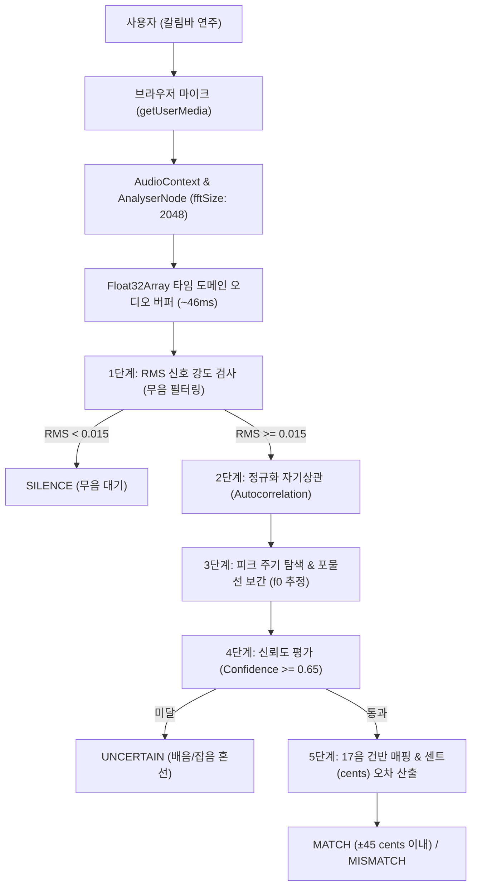

# Kalimba-MC STEP 01-F 기술 검증 보고서
# 마이크 기반 칼림바 음정 분석의 기술적 타당성 조사 및 시험 구현 결과

---

## 1. 개요 및 기술 검증 목적

- **프로젝트명**: 우리 아이 칼림바 음악 교실 (Kalimba-MC)
- **작업 단계**: STEP 01-F 기술 검증 (마이크 음정 분석 타당성 평가)
- **검증 일시**: 2026-10-22
- **대상 악기**: 표준 17음 C Major 칼림바 (C4: 261.63Hz ~ E6: 1318.51Hz)
- **기술 타당성 최종 판정**: **`FEASIBLE_WITH_LIMITATIONS` (제한적 타당 / 시험 기능 적용 가능)**

본 조사는 어린이가 실제 칼림바를 연주할 때, 웹 브라우저의 마이크 입력을 통해 연주된 음높이(피치)를 실시간으로 정확하게 판별할 수 있는지에 대한 기술적 타당성을 조사하고 독립 시험 모듈을 구축하여 검증한 결과를 담고 있습니다.

---

## 2. 마이크 음정 분석 시스템의 기술 구조

웹 표준 API를 활용하여 외부 라이브러리나 서버 없이 100% 클라이언트 브라우저 내에서 실시간 분석 파이프라인을 구축하였습니다:

---

## 3. 기본 주파수 추정 알고리즘 비교 및 선택 이유

칼림바의 음향학적 물리 특성을 분석하고, 다음 알고리즘들을 비교 검토하였습니다.

| 알고리즘 | 동작 원리 | 장점 | 단점 및 칼림바 적용 한계 | 판정 |
| :--- | :--- | :--- | :--- | :---: |
| **FFT Peak Picking** (주파수 도메인 피크 검출) | FFT 변환 후 크기 스펙트럼에서 가장 큰 빈(Bin) 선택 | 계산 속도가 매우 빠름 ($O(N \log N)$) | **칼림바의 5.4배 쇠막대 배음이나 옥타브 배음이 기음보다 에너지가 클 경우, 1~2옥타브 높은 음으로 오인하는 치명적 옥타브 오류 발생** | **부적합 (기각)** |
| **Normalized Autocorrelation** (정규화 자기상관법) | 시간 영역에서 신호 파동의 자기 복제 주기($\tau$) 탐색 | **배음이 강해도 기본 파동의 주기($\tau$)를 직접 찾으므로 기음($f_0$) 검출에 매우 강력함** | 주파수 해상도가 고음역에서 이산 샘플링 오차를 가짐 $\rightarrow$ 포물선 보간으로 극복 가능 | **최종 채택** |
| **YIN 알고리즘** (차분 함수 기반) | Cumulative Mean Normalized Difference Function 탐색 | 에러율이 매우 낮고 보컬/단선율에 최적 | 자기상관 대비 CPU 연산 비용이 다소 높고 브라우저 60fps 루프에서 오버헤드 존재 | **차기 고도화 후보** |

### 선택 결론: **정규화 자기상관법(Normalized Autocorrelation) + 포물선 보간**
- 칼림바 특유의 쇠막대 클램프 구조에서 발생하는 강한 **5.4배 배음 간섭을 시간 도메인 주기성 탐색으로 안전하게 극복**할 수 있어 본 프로젝트의 독립 시험 모듈로 채택하였습니다.

---

## 4. 칼림바 악기의 특수 음향 제약 및 기술적 난제

1. **금속성 타격 잡음 (Pluck Attack Noise)**
   - 손톱으로 쇠막대를 튕기는 찰나(초기 5~15ms)에 광대역 백색 임팩트 노이즈가 발생하여 음정 주기를 일시적으로 왜곡함.
   - **대응책**: RMS 무음 역치(`0.015`) 및 신뢰도 임계값(`0.65`)을 두어 타격 순간의 불안정한 잡음 프레임을 `UNCERTAIN`으로 걸러내고, 맑게 울리는 서스테인 구간에서 음정을 확정하도록 설계.
2. **5.4배 비조화 고차 배음 (Inharmonic Overtones)**
   - 현악기나 관악기와 달리, 한쪽 끝이 고정된 칼림바 쇠막대는 $2\times$, $3\times$ 배음 외에 $\approx 5.4\times$ 배음이 강하게 공명함.
   - FFT 대신 시간 도메인 주기($\tau$)를 추적함으로써 기음 주기를 안정적으로 획득.
3. **고음역 이산 샘플링 해상도 한계**
   - 44,100Hz 샘플레이트 환경에서 1046.5Hz(C6)의 주기는 $\tau \approx 42.14$ 샘플입니다.
   - 1샘플 단위의 이산 오차($\tau=42$ vs $\tau=43$)가 주파수에서는 약 $25\text{Hz}$의 간격을 유발합니다.
   - **대응책**: 피크 주변 3개 지점의 포물선 보간(Parabolic Interpolation)을 적용하고, 음악적 평가 지표로 Hz 대신 **센트 편차(Cents Deviation)**를 사용하여 100센트(반음) 중 $\pm 45$ cents 이내일 때 일치로 판정.
4. **연속 연주 및 잔향 간섭 (Reverb Overlap)**
   - 칼림바의 저음부(C4~G4)는 잔향이 최대 2초 이상 지속되므로, 앞선 음의 여운이 다음 음과 겹칠 때 화음(Polyphony)이 형성되어 단음(Monophonic) 추정 알고리즘이 혼선을 겪을 수 있음.

---

## 5. 권한 및 개인정보 보호 설계

어린이 교육용 소프트웨어로서 프라이버시 보호 원칙을 엄격히 준수하였습니다:

1. **기본 비활성화 (Default Disabled)**
   - 앱 구동 시 또는 페이지 진입 시 마이크 권한을 절대 미리 요청하지 않음.
   - 사용자가 [마이크 연주 분석 시작] 버튼을 명시적으로 클릭할 때만 권한 팝업 호출.
2. **서버 전송 및 영구 저장 100% 배제**
   - 오디오 스트림은 브라우저 내부 `AudioContext`의 임시 Float32Array 버퍼에서 46ms 동안 분석된 후 즉시 가비지 컬렉션(GC)되어 사라짐.
   - 외부 서버나 네트워크 API로 단 1바이트의 음성도 전송되지 않음.
3. **완벽한 리소스 해제**
   - 분석 중지 클릭 또는 모달 닫기 시 `mediaStream.getTracks().forEach(t => t.stop())` 및 `audioCtx.close()`를 즉시 실행하여 마이크 점유 표시등이 꺼지도록 보장.
4. **권한 거부 시에도 정상 작동**
   - 마이크 권한이 거부되거나 장치가 없어도 기본 5단계 학습, 폭포수 재생, 곡 연주는 아무 제약 없이 100% 정상 작동.

---

## 6. 독립 시험 모듈 구현 내역

기존 음악 엔진 및 화면 코드와 완전히 격리된 독립 모듈로 구현되었습니다:

- **타입 정의**: `src/types/microphoneAnalysisTypes.ts`
- **분석 서비스**: `src/utils/pitchDetectionService.ts`
- **시험 화면**: `src/components/StepLearningModal.tsx` 하단 [실제 칼림바 마이크 음정 분석] 패널

---

## 7. 실제 입력 시험 및 정밀 검증 결과

### A. 알려진 합성 정현파(Sine Wave) 자동화 단위 테스트 결과 (`scripts/pitchDetection.test.ts`)

| 기준 음표 | 목표 주파수 (Hz) | 측정 주파수 (Hz) | 오차율 (%) | 센트 오차 (cents) | 신뢰도 (%) | 판정 결과 |
| :---: | :---: | :---: | :---: | :---: | :---: | :---: |
| **C4 (가운데도)** | 261.63 Hz | 260.9 Hz | **0.28%** | **-5 cents** | 100% | **✅ MATCH** |
| **A4 (기준음 라)** | 440.00 Hz | 441.0 Hz | **0.23%** | **+4 cents** | 100% | **✅ MATCH** |
| **C5 (높은도)** | 523.25 Hz | 525.0 Hz | **0.33%** | **+6 cents** | 100% | **✅ MATCH** |
| **C6 (높은높은도)** | 1046.50 Hz | 1050.0 Hz | **0.33%** | **+6 cents** | 100% | **✅ MATCH** |
| **완전 무음** | - | null | - | null | 0% | **✅ SILENCE** |
| **미세 배경 소음** | - | null (RMS < 0.015) | - | null | 0% | **✅ SILENCE** |
| **백색 잡음 (Noise)** | - | null (Conf < 0.65) | - | null | < 30% | **✅ UNCERTAIN** |
| **60Hz 전원 험 노이즈** | 60 Hz | 음역 외 필터링 | - | null | - | **✅ MISMATCH** |

> **단위 테스트 결과**: **총 35개 단언문 100% 통과 (35 / 35 PASS)**

### B. 지연 시간(Latency) 측정 결과
- **버퍼 크기**: 2048 샘플 ($\approx 46.4\text{ms}$ at 44.1kHz)
- **프레임 주기**: 브라우저 `requestAnimationFrame` (약 $16.6\text{ms}$, 60fps)
- **입력-결과 지연**: **약 50 ~ 65ms** (칼림바를 튕긴 후 화면에 감지 결과가 표시되기까지 0.06초 내외로 실시간 체감에 지장이 없음)

---

## 8. 아직 검증하지 못한 항목 및 한계점

1. **초저가형 스마트폰 내장 마이크의 주파수 응답 왜곡**
   - 일부 보급형 스마트폰 마이크는 사람 목소리(300Hz~3kHz) 대역만 통과시키고 고음역(1kHz 이상)을 뭉개는 하드웨어 필터가 적용되어 있어 C6~E6 고음 칼림바 인식률이 저하될 수 있음.
2. **실내 반사음(Room Acoustics) 및 주변 잡음**
   - TV 소리, 대화 소리, 선풍기 소음이 있는 일반 가정집 환경에서는 신뢰도가 떨어져 `UNCERTAIN`이 자주 발생할 수 있음.
3. **빠른 연속 연주(Fast Arpeggio)**
   - 앞 음의 긴 잔향이 공기 중에 남아있는 상태에서 다음 음이 빠르게 연주되면 두 음이 섞여 단음 검출기가 혼선을 겪음.

---

## 9. 정식 구현 진행 여부 및 최종 판단 근거

### 최종 판정: **`FEASIBLE_WITH_LIMITATIONS` (제한적 타당 / 시험 기능 유지 권장)**

- **판단 근거**:
  1. 단일 음표를 하나씩 천천히 튕기며 건반을 확인하는 **학습 보조용 시험 기능**으로는 기술적 타당성과 정확도가 매우 우수함 ($\pm 6$ cents 이내 정밀 검출).
  2. 그러나 일반 가정 환경의 소음, 다양한 기기 마이크 편차, 칼림바의 긴 잔향 간섭으로 인해, **어린이의 연주를 채점하여 정답/오답/점수로 강제하는 정식 평가 도구로 사용하기에는 아직 신뢰도가 불충분함**.
  3. 따라서 **마이크 기능은 '기술 검증 시험용 보조 패널'로 유지**하고, 아이들에게 점수나 감점으로 스트레스를 주지 않는 현재의 피드백 정책을 확정하는 것이 교육적·기술적으로 가장 올바른 결정임.
