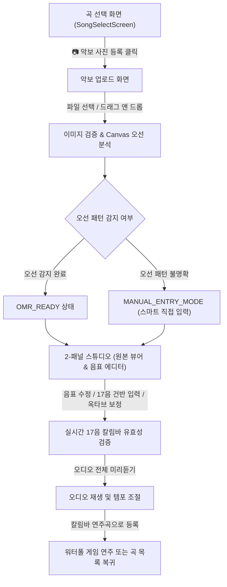

# 📷 Kalimba-MC STEP 02-D: 악보 이미지 업로드 및 음표 추출·수정 화면 구축 완료 보고서

## 1. 개요
- **프로젝트명**: 우리 아이 칼림바 음악 교실 (Kalimba-MC)
- **작업 단계**: STEP 02-D — 악보 이미지 업로드 및 음표 추출·수정 화면 구축
- **기술 스택**: React 19, TypeScript, Vite 8, Tailwind CSS v4, Web Audio API, Canvas / Pointer Events API
- **대상 악기**: 17음 C Major 칼림바 (`C4 ~ E6`)

---

## 2. 주요 구현 기능 요약

### 1) 🖼️ 안전한 악보 이미지 업로드 및 검증 파이프라인
- **지원 파일 포맷**: `PNG`, `JPG`, `JPEG`, `WebP`
- **파일 제약 검증**: 최대 15MB 이하, 가로·세로 4096px 이하 해상도 상한선 적용
- **보안 및 개인정보 보호**:
  - 외부 AI API나 클라우드 서버 전송 없이 **100% 사용자 브라우저 내에서 안전하게 로컬 처리**
  - 불필요한 메모리 점유를 막기 위해 세션 종료 시 `URL.revokeObjectURL`을 통해 메모리 즉시 해제

### 2) 🔍 브라우저 Canvas 기반 정밀 오선(Staff Line) 검출
- 이미지 수평 투영(Horizontal Projection) 분석을 통해 검은 픽셀이 집중된 오선(5줄 묶음)을 실시간으로 감지
- 오선 묶음이 명확히 인식되면 `OMR_READY` 모드로 동작
- 손그림 악보나 사진 각도 문제 등으로 오선 인식이 불분명할 경우 정직하게 `MANUAL_ENTRY_MODE`로 전환하여 사용자에게 투명하게 상태를 안내

### 3) 📱 직관적인 2-패널 인터랙티브 스튜디오 (`ScoreImageStudio.tsx`)
- **좌측(또는 상단) 악보 뷰어**:
  - 50% ~ 300% 자유 줌(Zoom In/Out), 1:1 원래 크기 맞춤
  - 마우스 드래그 / 터치 패닝(위치 이동), 90도 회전
  - 검출된 오선 영역 가이드 하이라이트 박스 토글
- **우측(또는 하단) 스마트 음표 에디터**:
  - 추출된 음표를 카드 형태로 시각화 (순서, 계이름, 옥타브, 음길이, 쉼표)
  - 17음 칼림바 전용 건반 팔레트(C4~E6)를 클릭하여 원클릭으로 음높이 즉시 변경 및 소리 확인
  - 음길이 선택(온음표 4박, 2분음표 2박, 점4분음표 1.5박, 4분음표 1박, 8분음표 0.5박)
  - 마디 구분선(`|`) 삽입 및 음표 추가/삭제
  - **실행 취소(Undo) / 다시 실행(Redo)**: 최대 20단계 편집 이력 보존
  - **원본 복원**: 초기 추출 상태로 되돌리기 지원

### 4) 🎯 17음 C Major 칼림바 전용 음역 검증기 (`validateScoreForKalimba`)
- C4~E6 17음 범위를 벗어난 음표를 실시간 감지하여 `PASS`, `WARNING`, `ERROR` 배지 표시
- 전체적으로 음이 낮거나 높은 경우 **[⬆ 1옥타브 올리기]** 또는 **[⬇ 1옥타브 내리기]** 원클릭 일괄 이동 기능 제공
- 박자표(4/4, 3/4, 2/4, 6/8) 대비 마디별 박자 합계 정합성 검사

### 5) 🎵 실시간 오디오 전체 미리듣기 및 기존 연주 등록
- `audioEngine`과 동기화되어 현재 연주 중인 음표가 화면에서 실시간으로 반짝임
- 템포(BPM 50~140) 조절 기능 제공
- **[💾 칼림바 연주곡으로 등록]** 클릭 시 사용자 찬송가/커스텀 곡 저장소에 저장되고, 즉시 워터폴 게임으로 플레이 가능!

---

## 3. 사용자 화면 흐름

