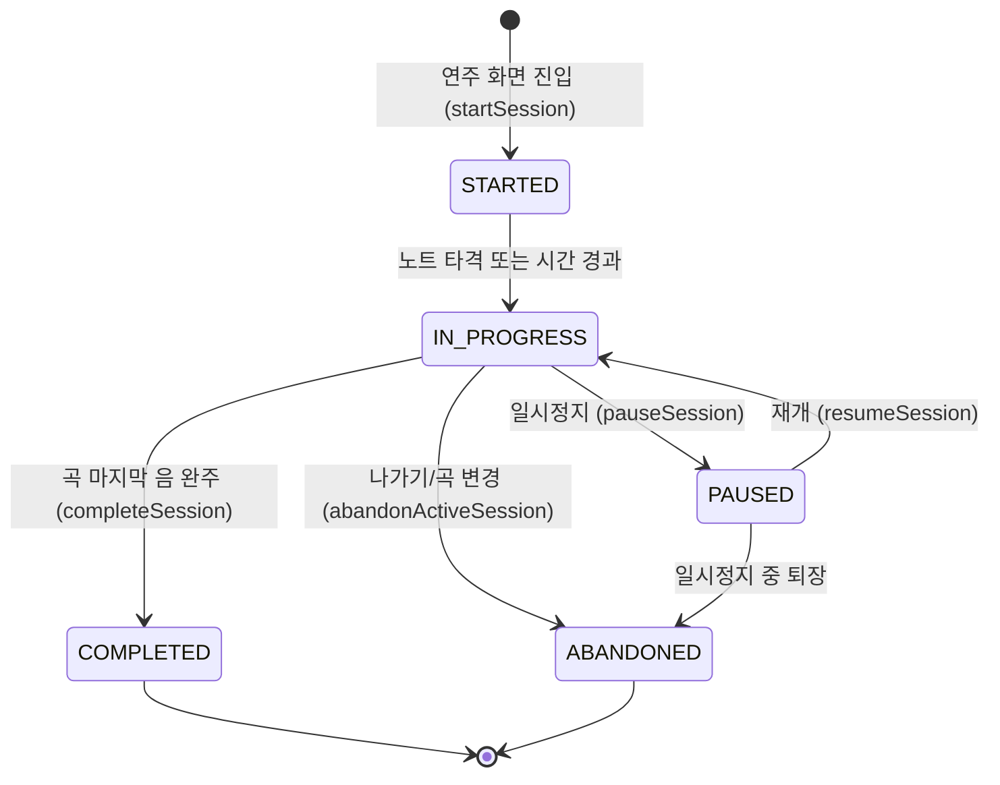

# 📊 Kalimba-MC STEP 02-E: 학습 기록 시스템 및 실제 세션 기록 보고서

## 1. 개요
- **프로젝트명**: 우리 아이 칼림바 음악 교실 (Kalimba-MC)
- **작업 단계**: STEP 02-E — 학습 기록 및 학부모 대시보드 구축
- **기술 스택**: React 19, TypeScript, Vite 8, Tailwind CSS v4, Web Audio API, `localStorage`
- **핵심 목표**: 가짜 데이터나 인위적인 점수 조작 없이, 어린이가 칼림바를 실제 연주한 활동만을 정확하게 기록하여 어린이의 성취감과 학부모의 신뢰를 확보한다.

---

## 2. 학습 세션 생명주기 및 상태 전이 모델



### 상태 정의 (`LearningSessionStatus`)
1. **`STARTED`**: 곡 선택 후 워터폴 연주 화면에 진입하여 세션이 생성된 초기 상태.
2. **`IN_PROGRESS`**: 실제 연주가 진행 중인 상태.
3. **`PAUSED`**: 스페이스바나 정지 버튼으로 연주를 멈춘 상태 (연습 시간 누적 일시 중지).
4. **`COMPLETED`**: 첫 음부터 마지막 음의 울림까지 모두 연주하여 곡을 정상 완주한 상태 (`isCompleted: true`).
5. **`ABANDONED`**: 곡 도중 나가기 버튼을 누르거나 다른 곡을 선택하여 완주하지 않고 종료된 상태 (`isCompleted: false`).
6. **`ERROR`**: 브라우저 예외나 데이터 무결성 오류 발생 상태.

---

## 3. 학습 세션 데이터 모델 (`LearningSessionRecord`)

```typescript
export interface LearningSessionRecord {
  id: string;                    // 고유 세션 ID ('session_1740000000_abc')
  songId: string;                // 곡 ID ('beginner-1', 'hymn-301' 등)
  songTitle: string;             // 곡 제목 스냅샷 (추후 곡명 변경 대비)
  difficulty: string;            // '쉬움', '보통', '어려움', '찬송가'
  speedPercent: number;          // 연주 속도 (70%, 100%, 130% 등)
  startTime: number;             // 시작 시각 (밀리초 타임스탬프)
  endTime: number;               // 종료 시각 (밀리초 타임스탬프)
  practiceDurationSec: number;   // 실제 순수 연습 시간 (일시정지 제외, 초)
  status: LearningSessionStatus; // 최종 상태
  isCompleted: boolean;          // 곡 완주 여부
  score?: number;                // 실제 산출 점수 (Perfect×100 + Great×60)
  accuracyPercent?: number;      // 실제 측정 정확도 (0~100%)
  maxCombo?: number;             // 최고 콤보
  perfectCount?: number;         // PERFECT 판정 수
  greatCount?: number;           // GREAT 판정 수
  missCount?: number;            // MISS 판정 수
  createdAt: number;             // 생성 시각
  updatedAt: number;             // 갱신 시각
}
```

---

## 4. 실제 활동 기반 기록 원칙 (데이터 정직성)

1. **가짜 활동 기록 절대 금지**:
   - 단순히 대시보드나 곡 목록 화면을 열었다고 해서 연습 세션을 생성하지 않습니다.
   - 곡을 선택하고 실제로 연주 화면에 진입한 시점에만 세션이 생성됩니다.
2. **중복 완료 방지 (멱등성 보장)**:
   - `finalizedSessionIds` 집합을 통해 한 번 완주된 세션에 대해 중복 완료 이벤트가 발생하더라도 1회만 확정 저장됩니다.
3. **새로고침 및 비정상 종료 시 자동 완주 방지**:
   - 사용자가 연주 도중 브라우저를 닫거나 새로고침하면 자동으로 완주로 둔갑하지 않고 `ABANDONED` 상태로 보존됩니다.
