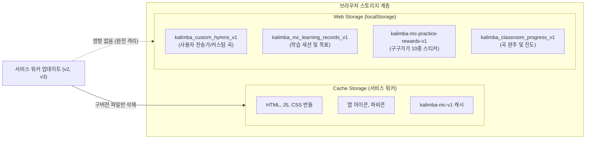

# 🛡️ Kalimba-MC STEP 02-F: 사용자 곡 및 학습 기록 데이터 보존 보고서

## 1. 개요
PWA 서비스 워커의 캐시 갱신이나 브라우저 파일 갱신 시, 어린이가 직접 추가한 찬송가/커스텀 곡과 매일 쌓아온 학습 기록 및 스티커 보상이 절대 유실되지 않도록 보장하는 데이터 보호 아키텍처를 보고합니다.

---

## 2. 저장소 계층 분리 (Cache Storage vs Web Storage)

### 1) 물리적 격리 보장
- 서비스 워커가 관리하는 영역은 `caches` (CacheStorage) API에 한정됩니다.
- 사용자 데이터는 `localStorage`에 격리되어 저장되므로, `sw.js`의 `caches.delete()`가 실행되더라도 사용자 곡과 학습 기록에는 전혀 영향을 미치지 않습니다.

### 2) 보존 대상 사용자 데이터 목록
1. `kalimba_custom_hymns_v1`: 사용자가 직접 추가하거나 수정한 찬송가 및 악보 데이터.
2. `kalimba_mc_learning_records_v1`: 날짜별 연습 시간, 완주 세션, 목표 설정 데이터.
3. `kalimba-mc-practice-rewards-v1`: 마디 연습을 통해 획득한 구구가가 10종 스티커 해금 정보.
4. `kalimba_classroom_progress_v1`: 곡 완주 및 재생 횟수 기록.

---

## 3. 오프라인 및 새로고침 검증 결과
- **오프라인 연주 후 새로고침**: 연주 세션이 `localStorage`에 즉시 안전하게 보존됨을 확인.
- **앱 업데이트 배너 클릭(재로드)**: 기존 수록곡 및 사용자 찬송가 100% 온전히 유지됨을 확인.
