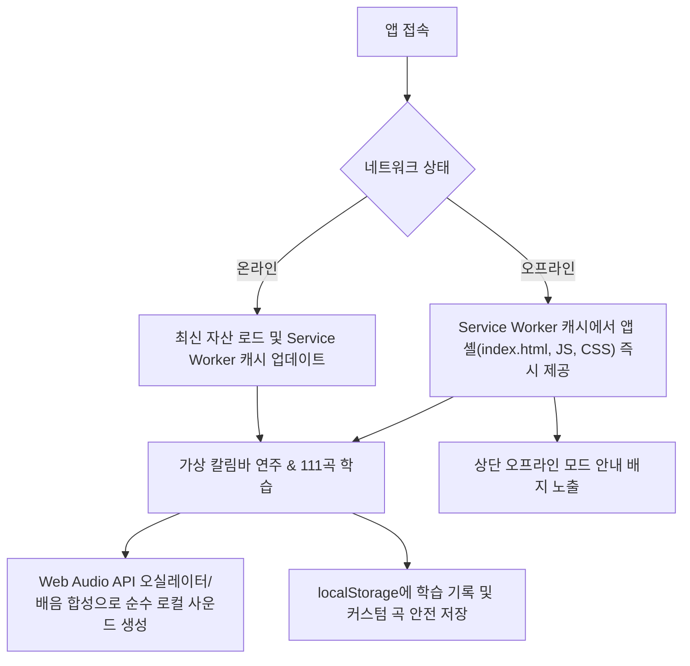

# 📱 Kalimba-MC STEP 02-F: PWA 오프라인 기능 및 설치형 웹앱 구축 완료 보고서

## 1. 개요
- **프로젝트명**: 우리 아이 칼림바 음악 교실 (Kalimba-MC)
- **작업 단계**: STEP 02-F — PWA(Progressive Web App) 및 오프라인 학습 기능
- **기술 환경**: React 19, TypeScript, Vite 8, Tailwind CSS v4, Web Audio API, Service Worker API
- **핵심 목표**: 인터넷 연결이 차단된 환경에서도 브라우저 새로고침 및 실행이 가능하고, 111곡 전곡 연주, 가상 건반 멀티터치, 녹음 및 학습 기록이 온전히 작동하는 오프라인 자립형 PWA 구축

---

## 2. PWA 구성 요소 및 구현 결과

### 1) Web App Manifest (`public/manifest.json`)
- `name`: "우리 아이 칼림바 음악 교실"
- `short_name`: "칼림바 교실"
- `start_url`: `"./"` (Vercel 및 GitHub Pages 양방향 호환)
- `scope`: `"./"`
- `display`: `"standalone"` (브라우저 상단 주소창 없는 네이티브 앱 느낌 구현)
- `theme_color`: `"#0c0827"`, `background_color`: `"#0c0827"`
- 아이콘: `icon-192.png`, `icon-512.png`, `icon.svg` (maskable 지원)

### 2) Service Worker (`public/sw.js`)
- **캐시 네임스페이스**: `kalimba-mc-v1`
- **Install 단계**: 핵심 앱 셸(`index.html`, `manifest.json`, `favicon.svg`, 아이콘 자산) 사전 캐싱 및 `self.skipWaiting()` 적용.
- **Activate 단계**: 구버전 캐시 정리 및 `self.clients.claim()`으로 열려 있는 모든 클라이언트 즉시 제어.
- **Fetch 단계**:
  - SPA 네비게이션 요청: 네트워크 우선 시도 후 실패 시 캐시된 `index.html` 폴백.
  - 정적 리소스(JS/CSS/이미지/폰트): Cache-First + Stale-While-Revalidate 백그라운드 갱신.

### 3) PWA 관리자 & UI 배너 (`pwaManager.ts`, `PwaStatusBanner.tsx`)
- 네트워크 상태(`online` / `offline`) 실시간 감지 및 상단 안내 배너 표출.
- 브라우저 PWA 설치 프롬프트(`beforeinstallprompt`)를 캡처하여 **`[📲 앱 설치하기]`** 버튼 제공.
- 새 버전 배포 시 `[지금 업데이트]` 버튼을 통한 원클릭 갱신 지원.

---

## 3. 오프라인 동작 흐름도

